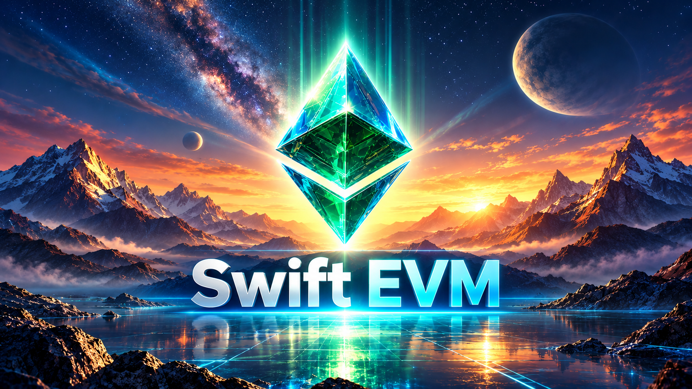

[](https://opensource.org/licenses/MIT)
[](https://github.com/mrLSD/swift-evm/actions/workflows/swift.yaml)
[](https://codecov.io/gh/mrLSD/swift-evm)
[](https://github.com/mrLSD/swift-evm/actions/workflows/swift.yaml)
[](https://swiftpackageindex.com/mrLSD/swift-evm)


<div align="center">
  

  <h1>mrLSD<code>/SwiftEVM</code></h1>
  <p><strong>Portable, compliant, and high-performance pure Swift implementation of the Ethereum Virtual Machine (EVM)</strong></p>
</div>

---

**SwiftEVM** is a modular EVM implementation for the Ethereum protocol, written in pure Swift. It is designed for low-overhead 
integration into blockchain nodes, embedded systems, and Layer-2 solutions requiring deterministic EVM bytecode execution.

Unlike general-purpose wrappers, SwiftEVM offers a ground-up implementation of the **Yellow Paper** and the Ethereum
Execution Layer Specifications ([EELS][eels]), optimizing critical paths (dispatch loop, stack operations, and memory
expansion) for Apple Silicon and other architectures.

### 📦 Swift Package Index
The project is indexed and verified on the Swift Package Index. You can view detailed build compatibility reports across platforms 
and generated documentation here:

[](https://swiftpackageindex.com/mrLSD/swift-evm)

---

## Key Features

*   **Yellow Paper and EELS Compliant:** Strict adherence to Ethereum protocol specifications; opcode semantics and gas are checked against [EELS][eels] for every supported hard fork.
*   **Zero-Copy Architecture:** Optimized memory handling to minimize ARC overhead in hot execution paths.
*   **Platform Agnostic:** Runs natively on **macOS**, **iOS**, **Linux**, and **WebAssembly (wasm32)** and many others.
*   **Uncompromising Reliability:** The codebase maintains **100% unit test coverage**. Every opcode, edge case, and gas calculation path is rigorously tested, ensuring production-grade stability and correctness rarely seen in early-stage implementations.
*   **Deterministic Execution:** 100% reproducible state transitions.
*   **Modular Design:** Decoupled components (Gasometer, Stack, Memory, Interpreter) allowing for custom extensions and instrumentation.

## Architecture

SwiftEVM is composed of specialized modules to ensure performance and correctness:

### 1. `PrimitiveTypes` (Arithmetic Core)
A dependency-free, fixed-width integer library built for the EVM's 256-bit word rather than a general-purpose BigInt.
*   **Inline value layout, no heap:** `U256` is four `UInt64` limbs stored directly in the struct, so an EVM word is a trivially copyable 32-byte value with no allocation, reference counting or dynamic length. Arithmetic works on the limbs in place; byte arrays are computed only at the EVM encoding boundary.
*   **EVM semantics are the API:** wrapping `+`, `-` and `*`; full-width intermediates for `ADDMOD` and `MULMOD` through `U512`; `I256` with two's-complement conversions, truncating signed division and remainder, canonical nonnegative zero and arithmetic shifts for `SDIV`, `SMOD` and `SAR`. Preconditions such as a nonzero divisor are explicit, and the opcodes implement the EVM's zero-result rules on top.
*   **One generic core:** `U128`, `U256`, `U512` and `I256` share the `BigUInt` protocol with little-endian limbs, explicit big-endian EVM encoding, hex parsing and Knuth Algorithm D division (normalization, quotient correction, add-back) built on `UInt64.dividingFullWidth`; hot paths are `@inlinable`, so the interpreter specializes them across the module boundary.
*   **Portable and deterministic:** pure Swift with no external dependencies and no platform-specific intrinsics, so results are identical on macOS, iOS, Linux and WebAssembly.
*   **Proven, not assumed:** over 500 examples cover zero, one, maxima, the signed minimum, every limb boundary, carry and borrow propagation, oversized shifts and endian conversions; seeded, reproducible property tests exercise full-width division and normalization for `U256` and `U512`; line and region coverage is 100% and enforced in CI.

### 2. `EVMCrypto` (Hashing)
Keccak-256 for the `KECCAK256` opcode, exposed as `Keccak256.hash` over a raw byte buffer.
*   **Two implementations:** CryptoSwift by default, or a native Keccak-f[1600] sponge selected by the `TinyKeccak` trait.
*   **Verified against the Keccak team's KAT corpus:** every byte-aligned `ShortMsgKAT`/`LongMsgKAT` vector, all `MonteCarlo` checkpoints and, in a separate CI job, the one-GiB `ExtremelyLongMsgKAT` vector.

### 3. `EVM` (Core Execution)
The heart of the virtual machine.
*   **Interpreter:** Optimized opcode dispatch loop.
*   **Stack:** Fixed-size, high-performance LIFO structure with boundary safety checks.
*   **Memory:** Dynamic linear memory with gas-metered expansion logic.
*   **Gasometer:** Exact gas accounting for opcodes, intrinsic costs, and memory expansion.

### 4. `Tracing`
Granular execution tracing for debugging and state analysis. Supports standard JSON-RPC trace formats and custom hooks for indexers.

---

## Implementation Status & Roadmap

The project targets the Ethereum specification upgrades listed below.

| Component | Status | Notes |
| :--- | :--- | :--- |
| **Machine State** | ✅ Complete | Stack, Memory, Context, Gas |
| **Opcode Logic** | ✅ Complete | Arithmetic, Bitwise, Control Flow, System |
| **Runtime** | 🔄 In Progress | Transaction context, Block environment |
| **Precompiles** | 🔄 In Progress | ECRecover, SHA256, RIPEMD160, Identity etc. |
| **zkEVM** | 🔜 Planned | Guest program, Block validation & execution |

### Compliance & Verification
*  ✅ **Unit Testing:** 100% Code Coverage enforced by CI and CodeCov.
*  🔜 **Ethereum State Tests:** Planned full integration with the official Ethereum Test Suite (execution-spec-tests) to guarantee pixel-perfect consensus compatibility.


### Hard Fork Support
Targeting compliance with the following upgrades:
*   ✅ **Berlin**
*   ✅ **London**
*   ✅ **Shanghai**
*   ✅ **Cancun**
*   🔜 **Prague / Osaka** (*Planned*)

---

## Integration

### Requirements
*   **Swift 6.1+** (Required for package traits).
*   **OS:** macOS 14+, iOS 17+, Ubuntu 22.04+, or any environment supporting Swift 6.

### Swift Package Manager
Add SwiftEVM to your `Package.swift` dependencies:

```swift
dependencies: [
    .package(url: "https://github.com/mrLSD/swift-evm.git", from: "0.6.11")
]
```

### Package traits

The default configuration uses CryptoSwift and compiles without instruction tracing.
Traits require Swift tools 6.1 or newer. To enable them from a consuming package,
use a SwiftEVM revision that contains these declarations; for a local checkout:

```swift
.package(
    path: "../evm-swift",
    traits: [.defaults, "TinyKeccak", "TraceStackInOut"]
)
```

| Trait | Effect |
| :--- | :--- |
| `TinyKeccak` | Selects the native Keccak-256 implementation instead of CryptoSwift. |
| `Tracing` | Compiles instruction tracing support. |
| `TraceStackInOut` | Collects per-instruction stack inputs and outputs. |
| `TraceHideMemory`, `TraceHideStack` | Hide memory or the stack in the default trace configuration. |
| `TraceCallTrace`, `TraceGasCalculation`, `TraceHideUnchanged`, `TraceHideStorage`, `TraceStorageHexValue`, `TraceOpcodeHexValue` | Set the corresponding existing `Trace.Config` defaults; they do not implement additional tracing features. |

Every `Trace...` trait also enables `Tracing`. Traits are combined across the
package dependency graph: one consumer enabling a trait enables it for that
shared package. An empty trait list cannot veto another consumer's selection.
CryptoSwift remains a dependency of `EVMCrypto` in both Keccak configurations.

```sh
swift test --enable-code-coverage
swift test --enable-code-coverage --traits TinyKeccak
swift test --enable-code-coverage --traits Tracing
swift test --enable-code-coverage --traits TinyKeccak,TraceStackInOut
```

Traits map to the existing compiler defines. `DISABLE_TRACING` remains the
explicit default marker; `TRACING` is the opt-in that the source checks.
Legacy global `-Xswiftc -D...` options still work, but package traits configure
SwiftEVM specifically and can be declared by a dependent package.

## Contributing

We welcome contributions from EVM experts and systems engineers. To maintain the integrity of the consensus engine, we enforce strict quality gates:

1.  **100% Test Coverage:** No code merges without full unit test coverage. Edge cases must be proven.
2.  **Linting:** Code must pass `swiftlint` and be formatted via `swiftformat`.
3.  **Performance:** PRs affecting the hot loop must demonstrate no regression in benchmarks.

### Development Environment

The **Keccak 1 GiB** job of the Swift GitHub Actions workflow runs on every
push and pull request to `master`, separately from the coverage matrix. It
executes the committed `ExtremelyLongMsgKAT_256` recipe from the Keccak team's
archive, 16 777 216 repetitions of a 64-byte text, against both backends in
release mode. The one-GiB input is generated in memory; allow several GiB of
available RAM for CryptoSwift's input copy. Ordinary test runs do not include it.
To opt in locally on macOS, set `EVM_KECCAK_EXTREMELY_LONG_KAT=1` and use the
job's release build and `xcrun xctest` commands. Selecting the entire
`Keccak256Spec` lets Quick discover its dynamic examples and keeps unrelated
assertion-trap tests out of this release run.

The full suite requires the debug assertion configuration: its trap tests
capture `precondition` messages, which `-O` builds do not print, and Nimble's
`throwAssertion()` can crash under `-O`. Run it with `swift test` (debug);
release runs are limited to `Keccak256Spec` in the Keccak 1 GiB job.

```bash
# Run test suite
swift test

# Run tests with prettified output
swift test | xcbeautify

# Show failed tests report only with details
./Tests/cli-test-runner
```

---

## License

SwiftEVM is released under the [MIT License](LICENSE).

[eels]: https://github.com/ethereum/execution-specs
